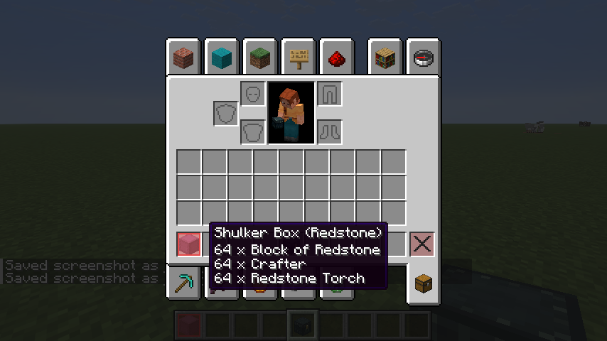
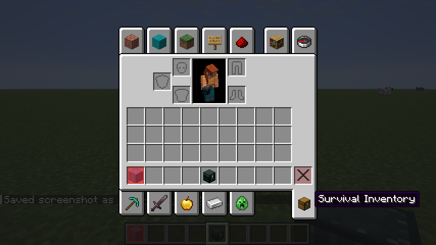
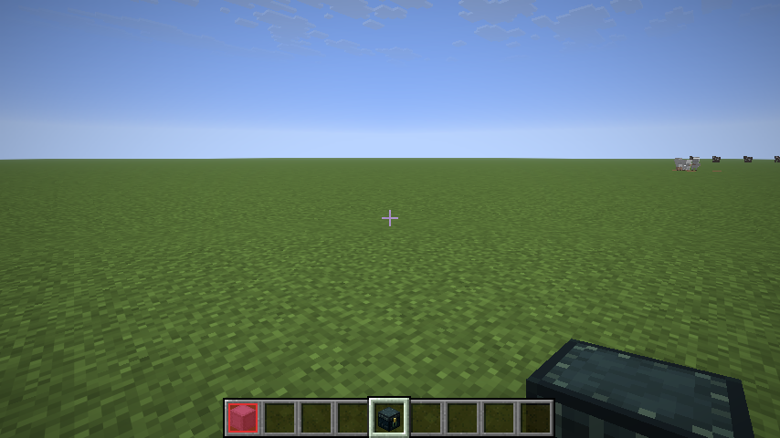
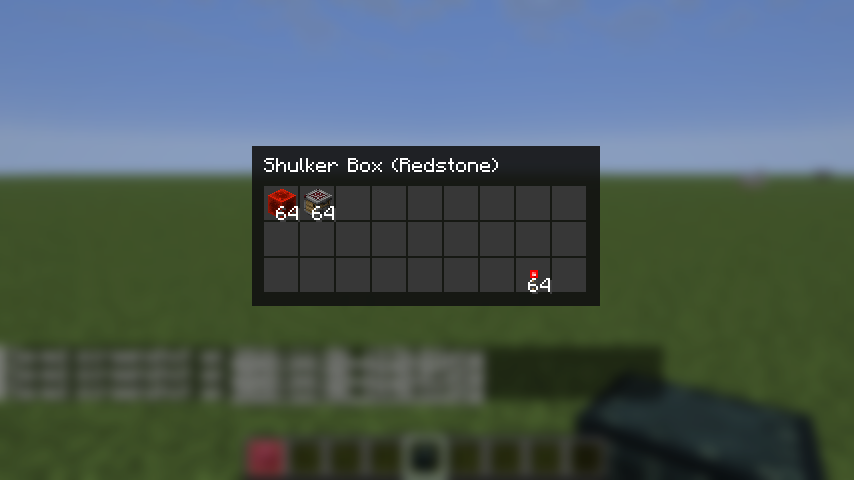
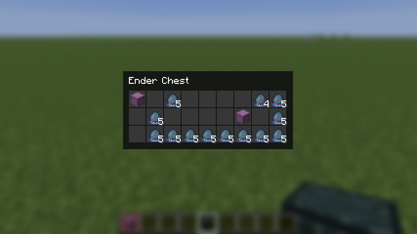
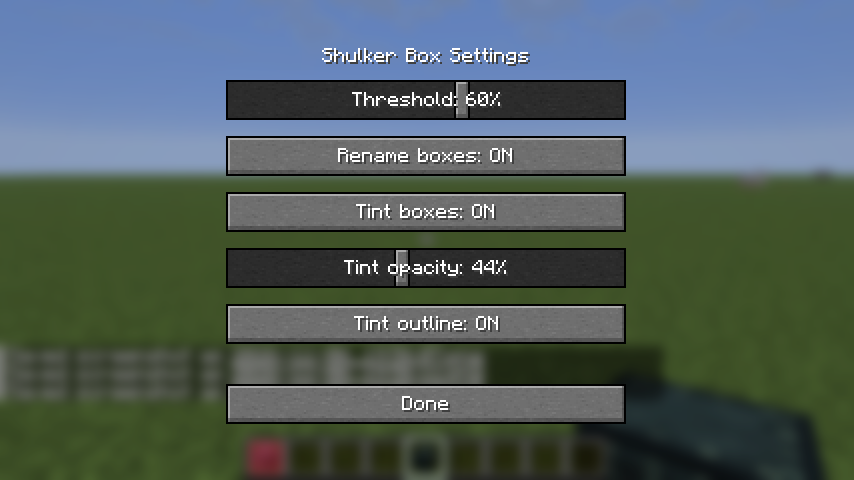

<p align="center"></p>

# ShulkerViewer

A small **client-side** Fabric mod that makes shulker boxes and ender chests easier to manage, without changing anything on the server.

- Detects what a shulker box contains and **names** and **tints** it accordingly
- **Previews** the contents of shulker boxes and ender chests without placing or opening them
- Everything is configurable in an in-game settings screen

Works on vanilla servers, because nothing is sent to or changed on the server.

## Features

### Content-based naming

If one category makes up at least a configurable share of a shulker box's non-empty slots (default **60 %**), the box is renamed client-side, e.g. `Shulker Box (Redstone)`. Boxes with a custom name (anvil) keep it.



Categories: Redstone, Food, Potions, Ores, Armor, Tools and Blocks.

### Tint

Boxes are tinted in the color of their category, in all inventory screens and in the hotbar. Opacity and the colored outline are adjustable.





### Contents preview

Hover a shulker box in any inventory screen and **right-click** (with an empty cursor) or press **V** to see what is inside, without placing it.



The preview closes with `Esc`, the inventory key, `V`, a right-click, or a click outside of it.

> Right-click no longer picks up a shulker box in inventories; use left-click for that.

### Ender chest preview

The same works for **ender chest items**. The client only learns the contents while the ender chest is open, so the preview shows what you saw last. Open the ender chest once per session to load it.



### Settings

Press **K** to open the settings screen (rebindable in the controls menu).



| Setting | Default | Description |
| --- | --- | --- |
| Threshold | 60 % | Share of non-empty slots a category needs to label the box |
| Rename boxes | on | Append the category to the box name |
| Tint boxes | on | Tint boxes in the category color |
| Tint opacity | 44 % | Opacity of the tint |
| Tint outline | on | Draw a colored outline around the slot |

Settings are stored in `config/shulkerviewer.json`.

## Controls

| Key | Action |
| --- | --- |
| Right-click on a box / ender chest item | Open the preview |
| `V` while hovering | Open the preview |
| `K` | Open the settings screen |

## Requirements

- Minecraft `26.3`
- [Fabric Loader](https://fabricmc.net/) `0.20.1` or newer
- [Fabric API](https://modrinth.com/mod/fabric-api)
- Java 25

Install by putting the JAR into your `mods` folder. It is only needed on the client.

## Download

Every push to `main` publishes a release with the built JAR on the [Releases](../../releases) page.

## Building

```sh
./gradlew build
```

The JAR is written to `build/libs/`. To start a development client:

```sh
./gradlew runClient
```

## Limitations

- Only the inventory view is tinted; boxes placed in the world and the hotbar item name are not.
- The ender chest preview only works for the ender chest item in an inventory, not for the block in the world, and shows the contents you last saw this session.
- Categories are derived from item IDs and components. The redstone item list lives in `ShulkerClassifier.java`.

## License

All rights reserved. See [LICENSE.txt](LICENSE.txt).
